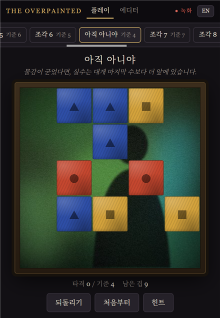
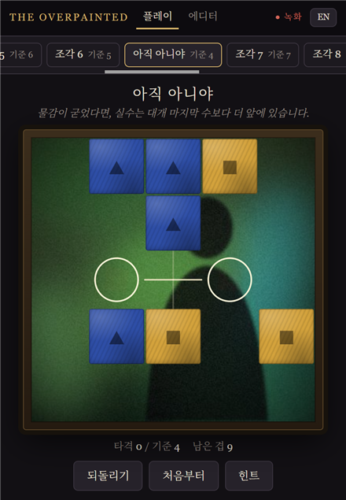
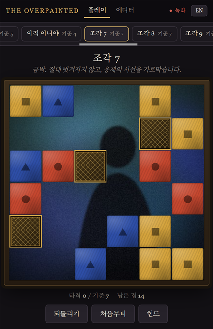
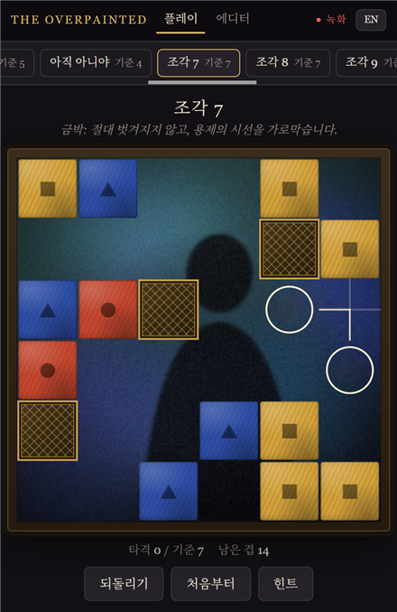

# The Overpainted — 개발 일지

> 무엇이 바뀌었는지는 git이 기억합니다. 이 문서는 **왜 바뀌었는지**를 기록합니다.
> 날짜와 시간은 한국 시간입니다. 각 시점은 git 태그로 되살릴 수 있습니다 (맨 아래 참고).

---

## 2026-11-16 · 출발점: 컬러 타일 → "덧칠된 사람"

빈칸을 두드리면 상하좌우로 가장 가까운 타일 중 같은 색끼리 사라지는 **컬러 타일** 계열의 규칙에서 출발했습니다. 원래 이런 게임의 재미는 **시간 제한 속 속도**에 있습니다.

여기에 이야기를 입혔습니다. **The Overpainted** — 미술품 복원가가 그림들을 복원하다가, 모든 그림에서 *한 사람이 덧칠로 지워져 있다*는 사실을 발견하는 미스터리입니다. 판을 다 지우면 원래 그림이 드러납니다.

이날 정한 것:
- **타이머 없음.** 속도가 아니라 수 읽기로 승부하는 순수 퍼즐. 언두 무제한, 기준(par)은 최소 타격 수.
- **양보다 질.** "10챕터 × 10스테이지" 같은 틀을 정하지 않는다. 채우기용 레벨은 만들지 않는다.
- 분위기는 미스터리, 시장은 글로벌 우선.

같은 날 저녁, 규칙 엔진 · 모든 경우를 탐색하는 솔버 · 레벨 생성기 · 플레이 화면과 에디터 · 레벨 12개로 된 첫 프로토타입이 나왔습니다. 처음부터 **솔버가 레벨의 난이도를 숫자로 잰다**는 방향이었습니다 (무작위로 두면 깰 확률 → "trap bits").

---

## 2026-11-17 · 첫 플레이 기록: "7번은 못 푸는 스테이지인 줄 알았어"

감으로 판단하지 않으려고 **플레이 기록 장치**를 먼저 달았습니다. 모든 타격 · 되돌리기 · 처음부터를 기록하고, 분석기가 그 수들을 솔버로 다시 두면서 *어느 수가 판을 못 풀게 만들었는지(블런더)*, *그걸 알아채기까지 몇 수·몇 초가 걸렸는지*를 계산합니다. 클리어 화면에는 체감 난이도 · "아하!" · 재미 버튼을 붙였습니다.

디자이너가 직접 12개 레벨을 플레이했습니다.

| 구간 | 체감 난이도 | 재미 | 메모 |
|---|---|---|---|
| 1–4 | 1–2 | 1–2 | 대부분 "아하" 없음 |
| 5–10 | 3 | 2–3 | |
| **7** | — | — | **클리어 실패** |
| 11–12 | **5** | **4** | 4–5분씩 고생하고도 가장 재미있었음 |

발견한 것:
- **어려울수록 재미있었다.** 타이머를 뺀 방향이 맞다는 첫 신호.
- 솔버 난이도(trap bits)와 체감 난이도의 순위 상관이 **0.99**. 숫자로 레벨을 걸러도 된다.
- 그런데 **7번만 예외**였다. 기록을 보니 세 번 도전하면서 **첫 수를 매번 같은 자리**에 뒀고, 그 첫 수가 이미 지는 수였다. 실수는 최대 5수 뒤에야 드러났고, 첫 시도에서는 이미 진 판에서 7수 · 120초를 더 두었다.

분석을 본 뒤 다른 순서로 두자 7번은 금방 풀렸습니다. 그리고 나온 말:

> "나는 못 푸는 스테이지인 줄 알았어."

이 한 문장이 방향을 바꿨습니다. 문제는 난이도가 아니라 **신뢰**였습니다. 플레이어가 "이 판은 풀 수 있다"는 믿음을 잃으면 더 고민하지 않고 떠납니다.

---

## 2026-11-18 · 신뢰를 지키는 두 가지

정답을 알려주지 않으면서 신뢰를 지키는 방법 중 두 가지만 골랐습니다.

1. **세계관 안에서 약속하기.** "모든 그림은 복원할 수 있습니다." 처음으로 실패할 수 있는 3번 레벨 안내 문구와, 막혔을 때의 메시지("물감이 굳었습니다… 실수는 더 앞에 있을지도 모릅니다")에 넣었다.
2. **순서를 가르치는 레벨을 7번 앞에.** 같은 수라도 *언제* 두느냐에 따라 판이 죽거나 산다는 걸 작은 판에서 먼저 겪게 한다. 이름은 **"아직 아니야 (Not Yet)"**.

> 실수한 순간 바로 "졌다"고 알려주는 방식은 일부러 택하지 않았습니다. 매 수가 정답인지 판정받는 게임이 되면, 11·12번에서 느낀 재미가 사라집니다.

---

## 2026-11-18 · Not Yet, 세 번 만들기 — "쉬운 문제부터 푼다"

**1차.** 솔버로 "처음 두면 막히지만 한 수 뒤에 두면 정답인 수"가 있는 판을 찾았다. → 디자이너: *너무 쉽다.* 빨간색이 눈에 띄어 먼저 눌렀는데, 그게 하필 정답이었다.

**2차.** 빨강과 황토색을 맞바꿔 함정 쪽을 빨강으로. (규칙은 색과 무관하니 구조는 그대로.) → 디자이너: 이번엔 노란색을 먼저 없애려 했다.

> "색상이 문제가 아닌 것 같아. 나는 타일 개수가 적은 것을 먼저 없애게 되는 것 같아.
> 시험 문제 풀 때 답이 뻔히 보이는 쉬운 문제부터 풀게 되는 느낌이랄까…"

두 번 모두 고른 건 **개수가 가장 적은 색**이었습니다. 색깔 가설은 틀렸습니다.

이걸 계기로 **첫 수 예측기**를 만들었습니다. 플레이어가 계산하기 전에 본능적으로 고를 수를 확률로 예측하고, 그 수가 지는 수인지 솔버로 판정합니다. 디자이너의 기록 107수로 맞춰 보니:

| 요인 | 결과 |
|---|---|
| **한 색을 끝내는 수** | 가장 강한 요인 |
| 가장 적은 색 | 두 번째 |
| 빨강인지 여부 | 거의 영향 없음 |

실제로 둔 수를 1순위로 맞힌 비율은 54%였습니다 (아무거나 찍으면 23%). 그리고 예측기는 2차 Not Yet을 "본능 수가 안전한 수 → 함정이 아니다"로 판정했습니다. 디자이너가 느낀 "너무 쉽다"를 도구가 그대로 재현한 것입니다.

**3차.** 예측기로 다시 찾았다. 조건: 본능 수가 *가장 적은 색을 끝내는 수*이고, 그게 지는 수이며, **같은 수를 나중에 두면 정답 수순에 들어갈 것.**

```
.BBC.
..B..
.A.A.     ← 빨강 두 개가 빈칸을 사이에 두고 마주 본다.
.BC.C       "쉬운 문제"이자 1번 레벨에서 배운 모양.
.....
```

- 예측: 91% 확률로 가운데를 쳐서 빨강 쌍을 지운다 → 2수 뒤 파랑 하나가 남아 막힌다.
- 정답: 파랑 쌍을 먼저 → **같은 가운데 자리**로 빨강 쌍 → 파랑 쌍 → 황토 셋을 한 번에.
- 본능대로 두면 질 확률: **97%**.

---

## 2026-11-18 · 디자이너가 말을 거는 게임

디자이너가 이런 이야기를 꺼냈습니다.

> "젤다의 전설 야숨, 포탈 2 등의 게임을 플레이하다 보면, 게임 디자이너가 플레이어에게 말을 거는 듯한 느낌을 받아.
> 내가 만드는 게임도 개발자와 대화를 하고 있는 듯한, 개발자가 플레이어를 훤히 꿰뚫어 보는 듯한 게임을 만들고 싶어."

이게 이 게임의 **경험 목표**가 되었습니다. 그리고 이 게임에는 플레이어에게 말을 거는 존재가 이미 세계관 안에 있었습니다. **그림마다 한 사람을 지워버린 덧칠꾼**입니다. 디자이너가 놓은 함정은 곧 덧칠꾼이 남긴 함정입니다.

"꿰뚫어 보는 느낌"을 만드는 데 필요한 세 가지로 나눠 정리했습니다.
1. **예측** — 플레이어의 첫 본능을 안다 → 첫 수 예측기
2. **타이밍** — 걸린 걸 바로 깨닫게 한다 → 가르치는 단계에서는 실수가 1~2수 안에 드러나게
3. **반응** — 게임이 플레이어를 기억하고 말한다 → 덧칠꾼의 대사

Not Yet에 덧칠꾼의 첫 대사를 넣었습니다. 붉은 잉크 쪽지처럼, 막히거나 클리어한 *뒤에만* 나타납니다.

| 언제 | 덧칠꾼 |
|---|---|
| 미끼를 첫 수로 두고 막혔을 때 | 쉬운 문제부터 풀었군. 다들 그래. |
| 한 번 걸렸다가 결국 풀었을 때 | 같은 자리였지. 순서만 달랐을 뿐. |
| 한 번도 안 걸리고 풀었을 때 | 안 걸렸군. 다음엔 어떨까. |

첫 대사가 디자이너 본인의 발견("쉬운 문제부터 푼다")에서 그대로 나왔다는 점이 재미있습니다. 디자이너는 직접 해보면서 미끼를 쳤고, 두 대사가 의도대로 나오는 것을 확인했습니다.

---

## 2026-11-18 · 두 겹 칠: 젤리 대신 물감

> "두 번 부셔야 하는 타일은 비주얼이 직관적이지가 않아서, 처음에는 두 번 매치해야 제거되는지 몰랐어.
> 캔디크러시 경우에는 젤리에 싸여 있었던 것 같은데… 우리 게임에 어울리면서 좀 더 직관적인 비주얼이어야 할 것 같아."

처음엔 "바니시(광택 코팅)"였고, 하얀 광택 테두리로만 표시했습니다. 아무 의미도 전달하지 못했습니다.

- **1차:** 같은 색 물감 두 장을 비스듬히 겹친 모습. 위 겹이 첫 매치에 날아간다. → 겹친 건 보이지만 칸 밖으로 삐져나와 어느 칸인지 애매했다.
- **2차:** 디자이너가 그려 온 스케치를 그대로 적용했다. **위에서 내려다본 두 겹** — 칸 전체가 아래 겹(어두운 테두리)이고, 안쪽에 솟아 있는 패널이 위 겹. 첫 매치에 패널이 들려 날아간다.


이름도 "바니시"에서 **"두 겹 칠"**로 바꿨습니다. 화면의 "남은 겹" 표시와 이름이 맞아떨어지고, 복원가가 물감을 한 겹씩 벗겨내는 이 게임의 소재와도 맞습니다. 아트 단계에서 지킬 원칙: *안쪽 패널 하나 = 한 번 더.*

---

## 2026-11-18 · 첫 외부 플레이테스트 준비

- 기본 언어를 한국어로 (EN 버튼으로 전환).
- GitHub에 공개하고, 지인이 받아서 바로 해볼 수 있게 README에 실행 방법을 적었다.
- 디자이너 본인의 플레이 기록은 `playtests/designer/`에 따로 보관한다. 지인 기록과 섞이지 않게.
- 이 시점에 태그 **`prototype-0.1`**.

**다음에 확인할 것:** 처음 하는 사람도 Not Yet에서 정말 "쉬운 문제부터" 치고 걸리는가? 그 경험 덕분에 7번에서 첫 수를 의심하게 되는가? 덧칠꾼의 대사는 "보고 있다"로 느껴지는가, "잔소리"로 느껴지는가?

---

## 2026-11-18 · 첫 지인 플레이테스트: 같은 미끼를 세 번

링크 하나로 보낸 첫 테스트. 지인 한 명이 휴대폰으로 13개 레벨을 **전부 최소 횟수로, 힌트 없이** 깼다.
그런데 기록을 한 수씩 읽어 보면, 숫자가 말해 주지 않는 이야기가 있다.

**Not Yet: 걸렸다. 그것도 세 번, 같은 수로.**
세 번 모두 첫 수는 개수가 가장 적은 빨간 두 장이었다. "가장 적은 색이 미끼"라는 가설 그대로다.

<p>


</p>

*왼쪽: 시작 화면. 오른쪽: 테스터가 세 번 모두 둔 첫 수, 빨간 두 장 사이를 친다. 정답 첫 수는 왼쪽 위 파란 두 장 사이 빈칸.*

첫 시도에서 막히자 덧칠꾼이 "쉬운 문제부터 풀었군. 다들 그래."라고 말했다. 그래도 다시 시작해서 **같은 첫 수**를 뒀고, 이미 진 판에서 1분을 더 헤맸다.
실패의 원인을 첫 수가 아니라 그 뒤의 수에서 찾고 있었던 것이다. 세 번째에는 첫 수를 두자마자 1.3초 만에 다시 시작했고, 그다음 판에서 깼다. 교훈이 들어가기까지 약 2분 반.
그리고 깬 직후, 7번을 8초 만에 나와 **Not Yet을 처음부터 다시** 했다. 이번엔 한 번에 ("안 걸렸군. 다음엔 어떨까."). 왜 돌아갔을까? 확인하고 싶었을까, 깨끗하게 깨고 싶었을까.

**7번: 의심은 했지만, 바꾸지는 못했다.**
첫 수 전에 60초를 고민했다. 그러고도 같은 틀린 첫 수를 두 번 뒀고, 두 번째에는 진 판에서 104초를 보냈다. 세 번째에야 첫 수를 바꿔서 깼다.
Not Yet의 교훈이 "첫 수를 의심하라"로 옮겨 가기는 했지만, "어떤 첫 수가 틀렸는지"까지는 아직이다.

<p>


</p>

*왼쪽: 시작 화면. 오른쪽: 두 번 둔 틀린 첫 수. 여기서도 빨간 두 장이다. 정답 첫 수는 오른쪽 아래, 노란 두 장을 먼저 지우는 칸.*

**덧칠꾼의 대사: 데이터로는 모른다.**
대사는 세 번만 나왔다. "막혔다" 대사는 더 둘 수 없을 때만 나오기 때문에, 진 줄 모르고 헤맨 두 번째와 세 번째 판에서는 침묵했다.
클리어 화면의 평가 버튼(체감 난이도, 아하, 재미)도 15번 깨는 동안 한 번도 눌리지 않았다. 느낌은 직접 물어봐야 한다.

**그 밖에 보인 것**
- **진 줄 모르는 시간이 길다.** 깰 수 없게 된 판에서 Not Yet은 약 1분, 7번은 1분이 넘는다. 알려 주지 않는 건 의도지만, 그게 답답했는지는 아직 모른다.
- **처음 연 브라우저에서 이어지지 않았다.** 1~6번을 깨고 Not Yet에서 멈춘 뒤 다른 브라우저로 다시 열었고, 진행과 이름이 따라오지 않아 1번부터 다시 했다. 메신저 앱 안의 브라우저로 처음 연 것으로 보인다.
- **난이도 곡선은 예측대로였다.** 레벨별 함정 점수와 실제 시간·실수의 상관이 0.72~0.80. 다만 테스터는 한 명이다.
- 다 깬 뒤에도 12번을 두 번 더 다시 시작했고, 나중에 두 번 더 열어 봤다.

**다음에 물어볼 것:** Not Yet을 왜 다시 했는지. 덧칠꾼의 말이 "보고 있다"였는지 "잔소리"였는지. 진 줄 모르고 헤맨 시간이 답답했는지, 아니면 그게 퍼즐이었는지.

---

## 그 시점을 다시 플레이하려면

```
git checkout prototype-0.1
node tools/serve.mjs          # http://localhost:5173
```

외부 라이브러리를 쓰지 않아서 (브라우저와 Node 기본 기능만), 오래 지나도 그대로 돌아가도록 만들었습니다.
최신으로 돌아오려면 `git checkout main`.

| 태그 | 날짜 | 무엇 |
|---|---|---|
| `prototype-0.1` | 2026-11-18 | 첫 플레이어블. 13개 레벨, Not Yet 3차, 덧칠꾼 대사, 두 겹 칠 2차, 한국어 |
