# The Overpainted — 개발 일지

> 무엇이 바뀌었는지는 git이 기억합니다. 이 문서는 **왜 바뀌었는지**를 기록합니다.
> 날짜와 시간은 한국 시간입니다. 각 시점은 git 태그로 되살릴 수 있습니다 (맨 아래 참고).

---

## 2026-11-16 · 출발점: 컬러 타일 → "덧칠된 사람"

빈칸을 두드리면 상하좌우로 가장 가까운 타일 중 같은 색끼리 사라지는 **컬러 타일** 계열의 규칙에서 출발했습니다. 원래 이런 게임의 재미는 **시간 제한 속 속도**에 있습니다.

여기에 이야기를 입혔습니다. **The Overpainted** — 미술품 복원가가 그림들을 복원하다가, 모든 그림에서 *한 사람이 덧칠로 지워져 있다*는 사실을 발견하는 미스터리입니다. 판을 다 지우면 원래 그림이 드러납니다.

이날 정한 것:
- **타이머 없음.** 속도가 아니라 수 읽기로 승부하는 순수 퍼즐. 언두 무제한, 기준(par)은 최소 타격 수.
- **양보다 질.** "10챕터 × 10스테이지" 같은 틀을 정하지 않는다. 채우기용 레벨은 만들지 않는다.
- 분위기는 미스터리, 시장은 글로벌 우선.

같은 날 저녁, 규칙 엔진 · 모든 경우를 탐색하는 솔버 · 레벨 생성기 · 플레이 화면과 에디터 · 레벨 12개로 된 첫 프로토타입이 나왔습니다. 처음부터 **솔버가 레벨의 난이도를 숫자로 잰다**는 방향이었습니다 (무작위로 두면 깰 확률 → "trap bits").

---

## 2026-11-17 · 첫 플레이 기록: "7번은 못 푸는 스테이지인 줄 알았어"

감으로 판단하지 않으려고 **플레이 기록 장치**를 먼저 달았습니다. 모든 타격 · 되돌리기 · 처음부터를 기록하고, 분석기가 그 수들을 솔버로 다시 두면서 *어느 수가 판을 못 풀게 만들었는지(블런더)*, *그걸 알아채기까지 몇 수·몇 초가 걸렸는지*를 계산합니다. 클리어 화면에는 체감 난이도 · "아하!" · 재미 버튼을 붙였습니다.

디자이너가 직접 12개 레벨을 플레이했습니다.

| 구간 | 체감 난이도 | 재미 | 메모 |
|---|---|---|---|
| 1–4 | 1–2 | 1–2 | 대부분 "아하" 없음 |
| 5–10 | 3 | 2–3 | |
| **7** | — | — | **클리어 실패** |
| 11–12 | **5** | **4** | 4–5분씩 고생하고도 가장 재미있었음 |

발견한 것:
- **어려울수록 재미있었다.** 타이머를 뺀 방향이 맞다는 첫 신호.
- 솔버 난이도(trap bits)와 체감 난이도의 순위 상관이 **0.99**. 숫자로 레벨을 걸러도 된다.
- 그런데 **7번만 예외**였다. 기록을 보니 세 번 도전하면서 **첫 수를 매번 같은 자리**에 뒀고, 그 첫 수가 이미 지는 수였다. 실수는 최대 5수 뒤에야 드러났고, 첫 시도에서는 이미 진 판에서 7수 · 120초를 더 두었다.

분석을 본 뒤 다른 순서로 두자 7번은 금방 풀렸습니다. 그리고 나온 말:

> "나는 못 푸는 스테이지인 줄 알았어."

이 한 문장이 방향을 바꿨습니다. 문제는 난이도가 아니라 **신뢰**였습니다. 플레이어가 "이 판은 풀 수 있다"는 믿음을 잃으면 더 고민하지 않고 떠납니다.

---

## 2026-11-18 · 신뢰를 지키는 두 가지

정답을 알려주지 않으면서 신뢰를 지키는 방법 중 두 가지만 골랐습니다.

1. **세계관 안에서 약속하기.** "모든 그림은 복원할 수 있습니다." 처음으로 실패할 수 있는 3번 레벨 안내 문구와, 막혔을 때의 메시지("물감이 굳었습니다… 실수는 더 앞에 있을지도 모릅니다")에 넣었다.
2. **순서를 가르치는 레벨을 7번 앞에.** 같은 수라도 *언제* 두느냐에 따라 판이 죽거나 산다는 걸 작은 판에서 먼저 겪게 한다. 이름은 **"아직 아니야 (Not Yet)"**.

> 실수한 순간 바로 "졌다"고 알려주는 방식은 일부러 택하지 않았습니다. 매 수가 정답인지 판정받는 게임이 되면, 11·12번에서 느낀 재미가 사라집니다.

---

## 2026-11-18 · Not Yet, 세 번 만들기 — "쉬운 문제부터 푼다"

**1차.** 솔버로 "처음 두면 막히지만 한 수 뒤에 두면 정답인 수"가 있는 판을 찾았다. → 디자이너: *너무 쉽다.* 빨간색이 눈에 띄어 먼저 눌렀는데, 그게 하필 정답이었다.

**2차.** 빨강과 황토색을 맞바꿔 함정 쪽을 빨강으로. (규칙은 색과 무관하니 구조는 그대로.) → 디자이너: 이번엔 노란색을 먼저 없애려 했다.

> "색상이 문제가 아닌 것 같아. 나는 타일 개수가 적은 것을 먼저 없애게 되는 것 같아.
> 시험 문제 풀 때 답이 뻔히 보이는 쉬운 문제부터 풀게 되는 느낌이랄까…"

두 번 모두 고른 건 **개수가 가장 적은 색**이었습니다. 색깔 가설은 틀렸습니다.

이걸 계기로 **첫 수 예측기**를 만들었습니다. 플레이어가 계산하기 전에 본능적으로 고를 수를 확률로 예측하고, 그 수가 지는 수인지 솔버로 판정합니다. 디자이너의 기록 107수로 맞춰 보니:

| 요인 | 결과 |
|---|---|
| **한 색을 끝내는 수** | 가장 강한 요인 |
| 가장 적은 색 | 두 번째 |
| 빨강인지 여부 | 거의 영향 없음 |

실제로 둔 수를 1순위로 맞힌 비율은 54%였습니다 (아무거나 찍으면 23%). 그리고 예측기는 2차 Not Yet을 "본능 수가 안전한 수 → 함정이 아니다"로 판정했습니다. 디자이너가 느낀 "너무 쉽다"를 도구가 그대로 재현한 것입니다.

**3차.** 예측기로 다시 찾았다. 조건: 본능 수가 *가장 적은 색을 끝내는 수*이고, 그게 지는 수이며, **같은 수를 나중에 두면 정답 수순에 들어갈 것.**

```
.BBC.
..B..
.A.A.     ← 빨강 두 개가 빈칸을 사이에 두고 마주 본다.
.BC.C       "쉬운 문제"이자 1번 레벨에서 배운 모양.
.....
```

- 예측: 91% 확률로 가운데를 쳐서 빨강 쌍을 지운다 → 2수 뒤 파랑 하나가 남아 막힌다.
- 정답: 파랑 쌍을 먼저 → **같은 가운데 자리**로 빨강 쌍 → 파랑 쌍 → 황토 셋을 한 번에.
- 본능대로 두면 질 확률: **97%**.

---

## 2026-11-18 · 디자이너가 말을 거는 게임

디자이너가 이런 이야기를 꺼냈습니다.

> "젤다의 전설 야숨, 포탈 2 등의 게임을 플레이하다 보면, 게임 디자이너가 플레이어에게 말을 거는 듯한 느낌을 받아.
> 내가 만드는 게임도 개발자와 대화를 하고 있는 듯한, 개발자가 플레이어를 훤히 꿰뚫어 보는 듯한 게임을 만들고 싶어."

이게 이 게임의 **경험 목표**가 되었습니다. 그리고 이 게임에는 플레이어에게 말을 거는 존재가 이미 세계관 안에 있었습니다. **그림마다 한 사람을 지워버린 덧칠꾼**입니다. 디자이너가 놓은 함정은 곧 덧칠꾼이 남긴 함정입니다.

"꿰뚫어 보는 느낌"을 만드는 데 필요한 세 가지로 나눠 정리했습니다.
1. **예측** — 플레이어의 첫 본능을 안다 → 첫 수 예측기
2. **타이밍** — 걸린 걸 바로 깨닫게 한다 → 가르치는 단계에서는 실수가 1~2수 안에 드러나게
3. **반응** — 게임이 플레이어를 기억하고 말한다 → 덧칠꾼의 대사

Not Yet에 덧칠꾼의 첫 대사를 넣었습니다. 붉은 잉크 쪽지처럼, 막히거나 클리어한 *뒤에만* 나타납니다.

| 언제 | 덧칠꾼 |
|---|---|
| 미끼를 첫 수로 두고 막혔을 때 | 쉬운 문제부터 풀었군. 다들 그래. |
| 한 번 걸렸다가 결국 풀었을 때 | 같은 자리였지. 순서만 달랐을 뿐. |
| 한 번도 안 걸리고 풀었을 때 | 안 걸렸군. 다음엔 어떨까. |

첫 대사가 디자이너 본인의 발견("쉬운 문제부터 푼다")에서 그대로 나왔다는 점이 재미있습니다. 디자이너는 직접 해보면서 미끼를 쳤고, 두 대사가 의도대로 나오는 것을 확인했습니다.

---

## 2026-11-18 · 두 겹 칠: 젤리 대신 물감

> "두 번 부셔야 하는 타일은 비주얼이 직관적이지가 않아서, 처음에는 두 번 매치해야 제거되는지 몰랐어.
> 캔디크러시 경우에는 젤리에 싸여 있었던 것 같은데… 우리 게임에 어울리면서 좀 더 직관적인 비주얼이어야 할 것 같아."

처음엔 "바니시(광택 코팅)"였고, 하얀 광택 테두리로만 표시했습니다. 아무 의미도 전달하지 못했습니다.

- **1차:** 같은 색 물감 두 장을 비스듬히 겹친 모습. 위 겹이 첫 매치에 날아간다. → 겹친 건 보이지만 칸 밖으로 삐져나와 어느 칸인지 애매했다.
- **2차:** 디자이너가 그려 온 스케치를 그대로 적용했다. **위에서 내려다본 두 겹** — 칸 전체가 아래 겹(어두운 테두리)이고, 안쪽에 솟아 있는 패널이 위 겹. 첫 매치에 패널이 들려 날아간다.


이름도 "바니시"에서 **"두 겹 칠"**로 바꿨습니다. 화면의 "남은 겹" 표시와 이름이 맞아떨어지고, 복원가가 물감을 한 겹씩 벗겨내는 이 게임의 소재와도 맞습니다. 아트 단계에서 지킬 원칙: *안쪽 패널 하나 = 한 번 더.*

---

## 2026-11-18 · 첫 외부 플레이테스트 준비

- 기본 언어를 한국어로 (EN 버튼으로 전환).
- GitHub에 공개하고, 지인이 받아서 바로 해볼 수 있게 README에 실행 방법을 적었다.
- 디자이너 본인의 플레이 기록은 `playtests/designer/`에 따로 보관한다. 지인 기록과 섞이지 않게.
- 이 시점에 태그 **`prototype-0.1`**.

**다음에 확인할 것:** 처음 하는 사람도 Not Yet에서 정말 "쉬운 문제부터" 치고 걸리는가? 그 경험 덕분에 7번에서 첫 수를 의심하게 되는가? 덧칠꾼의 대사는 "보고 있다"로 느껴지는가, "잔소리"로 느껴지는가?

---

## 2026-11-18 · 첫 지인 플레이테스트: 같은 미끼를 세 번

링크 하나로 보낸 첫 테스트. 지인 한 명이 휴대폰으로 13개 레벨을 **전부 최소 횟수로, 힌트 없이** 깼다.
그런데 기록을 한 수씩 읽어 보면, 숫자가 말해 주지 않는 이야기가 있다.

**Not Yet: 걸렸다. 그것도 세 번, 같은 수로.**
세 번 모두 첫 수는 개수가 가장 적은 빨간 두 장이었다. "가장 적은 색이 미끼"라는 가설 그대로다.

<p>


</p>

*왼쪽: 시작 화면. 오른쪽: 테스터가 세 번 모두 둔 첫 수, 빨간 두 장 사이를 친다. 정답 첫 수는 왼쪽 위 파란 두 장 사이 빈칸.*

첫 시도에서 막히자 덧칠꾼이 "쉬운 문제부터 풀었군. 다들 그래."라고 말했다. 그래도 다시 시작해서 **같은 첫 수**를 뒀고, 이미 진 판에서 1분을 더 헤맸다.
실패의 원인을 첫 수가 아니라 그 뒤의 수에서 찾고 있었던 것이다. 세 번째에는 첫 수를 두자마자 1.3초 만에 다시 시작했고, 그다음 판에서 깼다. 교훈이 들어가기까지 약 2분 반.
그리고 깬 직후, 7번을 8초 만에 나와 **Not Yet을 처음부터 다시** 했다. 이번엔 한 번에 ("안 걸렸군. 다음엔 어떨까."). 왜 돌아갔을까? 확인하고 싶었을까, 깨끗하게 깨고 싶었을까.

**7번: 의심은 했지만, 바꾸지는 못했다.**
첫 수 전에 60초를 고민했다. 그러고도 같은 틀린 첫 수를 두 번 뒀고, 두 번째에는 진 판에서 104초를 보냈다. 세 번째에야 첫 수를 바꿔서 깼다.
Not Yet의 교훈이 "첫 수를 의심하라"로 옮겨 가기는 했지만, "어떤 첫 수가 틀렸는지"까지는 아직이다.

<p>


</p>

*왼쪽: 시작 화면. 오른쪽: 두 번 둔 틀린 첫 수. 여기서도 빨간 두 장이다. 정답 첫 수는 오른쪽 아래, 노란 두 장을 먼저 지우는 칸.*

**덧칠꾼의 대사: 데이터로는 모른다.**
대사는 세 번만 나왔다. "막혔다" 대사는 더 둘 수 없을 때만 나오기 때문에, 진 줄 모르고 헤맨 두 번째와 세 번째 판에서는 침묵했다.
클리어 화면의 평가 버튼(체감 난이도, 아하, 재미)도 15번 깨는 동안 한 번도 눌리지 않았다. 느낌은 직접 물어봐야 한다.

**그 밖에 보인 것**
- **진 줄 모르는 시간이 길다.** 깰 수 없게 된 판에서 Not Yet은 약 1분, 7번은 1분이 넘는다. 알려 주지 않는 건 의도지만, 그게 답답했는지는 아직 모른다.
- **처음 연 브라우저에서 이어지지 않았다.** 1~6번을 깨고 Not Yet에서 멈춘 뒤 다른 브라우저로 다시 열었고, 진행과 이름이 따라오지 않아 1번부터 다시 했다. 메신저 앱 안의 브라우저로 처음 연 것으로 보인다.
- **난이도 곡선은 예측대로였다.** 레벨별 함정 점수와 실제 시간·실수의 상관이 0.72~0.80. 다만 테스터는 한 명이다.
- 다 깬 뒤에도 12번을 두 번 더 다시 시작했고, 나중에 두 번 더 열어 봤다.

**다음에 물어볼 것:** Not Yet을 왜 다시 했는지. 덧칠꾼의 말이 "보고 있다"였는지 "잔소리"였는지. 진 줄 모르고 헤맨 시간이 답답했는지, 아니면 그게 퍼즐이었는지.

---

## 2026-11-19 · 두 번째 테스터: 손으로 더듬는 플레이어

두 번째 지인은 PC 브라우저로, 여러 번 자리를 비웠다 돌아오며 약 6시간에 걸쳐 17개 레벨 중 15개를 깼다. 힌트는 쓰지 않았다.
깬 레벨은 모두 최소 횟수였다. 하지만 거기까지 가는 길이 첫 테스터와 전혀 달랐다.

| | 첫 테스터 | 두 번째 테스터 |
|---|---|---|
| 클리어 | 13 / 13 | 15 / 17 (11번에서 포기, 12번은 열지 않음) |
| 헛친 탭 (아무것도 녹지 않은 탭) | 4 | **139** |
| 함정 점수와 걸린 시간의 상관 | 0.74 | 0.19 |

첫 테스터는 함정 점수대로 어려워했다. 두 번째 테스터는 3·4번에서 크게 막히고, 5번부터 10번까지는 거의 한 번에 지나가고, 11번에서 다시 막혔다.

**헛친 탭 139번: 계산하지 않고 두드려 본다.**
헛친 탭은 대부분 1.4초 안팎으로 짧았다. 75번은 이미 진 판에서, 21번은 더 둘 수 없는 판에서 나왔다.
치면 시선이 잠깐 그려지니, 탭이 공짜 "미리 보기"처럼 쓰였다. 머리로 수를 읽는 대신 손으로 판을 더듬는 플레이다.

**3번: "다른 색끼리는 녹지 않는다"를 여기서 처음 배웠다.**
24초를 보고 나서 첫 탭. 왼쪽 아래 빈칸을 **다섯 번 연달아** 쳤다. 이 칸은 위로 빨강, 오른쪽으로 파랑을 본다. 색이 달라서 아무것도 녹지 않는다.
1번과 2번은 어디를 쳐도 녹는 판이라, 색이 안 맞으면 헛친다는 걸 보여 주는 레벨이 없다.
그다음 첫 수는 빨강 세 장을 한꺼번에 치는 수. 첫 세 판이 모두 이 "욕심"으로 졌다.

<p>
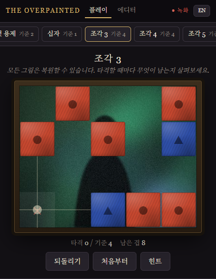
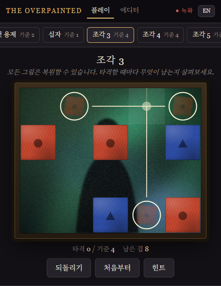
</p>

*왼쪽: 다섯 번 연달아 친 칸. 위는 빨강, 오른쪽은 파랑이라 아무것도 녹지 않는다. 오른쪽: 첫 세 판의 첫 수. 빨강 세 장을 한 번에 지우면 빨강이 홀수로 남아 짝이 없다.*

**4번: 같은 지는 수를 반복했다.**
다시 시작 10번, 블런더 15번. 판마다 첫 수를 바꾸기는 했지만 같은 지는 수로 돌아왔다. 오른쪽 아래 빨강 한 쌍이 네 번, 파랑 세 장이 네 번.
도중에 몇 시간 자리를 비웠고, 돌아와서 **개발자 오버레이를 2초 켰다가 껐다.** 그로부터 약 100초 뒤에 깼다.
오버레이를 보고 푼 건지, 키를 잘못 누른 건지는 기록만으로는 모른다. (테스터용 웹 빌드에서도 D 키로 오버레이가 켜진다.)

<p>
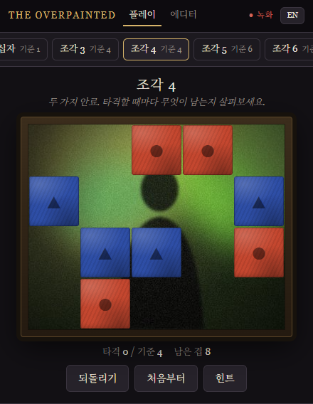
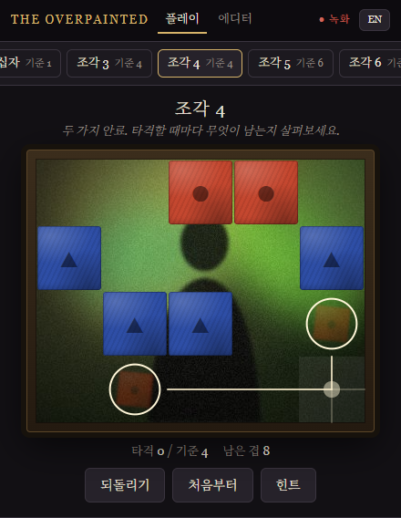
</p>

*왼쪽: 시작 화면. 오른쪽: 네 번 둔 지는 첫 수. 아래 줄 빨강과 오른쪽 빨강을 친다. 남은 빨강 둘은 위에서 붙어 있어 서로를 못 본다.*

**4번 다음은 순식간이었다.**
5번부터 10번까지 10개 레벨을, 7번 하나만 빼면 다시 시작 3번으로 모두 최소 횟수로 깼다. Not Yet과 끝까지는 첫 판에 깼다 (Not Yet의 덧칠꾼: "안 걸렸군. 다음엔 어떨까.").
3·4번에서 고생하며 규칙이 손에 붙은 것으로 보인다. 첫 테스터를 세 번 잡은 Not Yet이 이 테스터에게는 함정이 되지 않았다.

**7번: 첫 테스터와 같은 미끼.**
일곱 판 중 다섯 판을 같은 첫 수로 시작했다. 오른쪽 빨강 두 장. 빨강은 4장으로, 파랑과 함께 가장 적은 색이다.
첫 테스터도 이 수에 두 번 걸렸다. 사람이 바뀌어도 같은 수에 걸렸으니, 이 미끼는 확실히 통한다. ([2026-11-18 사진](#2026-11-18--첫-지인-플레이테스트-같은-미끼를-세-번) 오른쪽이 바로 그 수다.)

**11번: 함정은 통했는데, 빠져나오지 못했다.**
19분 동안 19판. 블런더 22번 끝에 그만뒀다. 첫 테스터는 4분이 안 걸려 깬 레벨이다.
첫 수 19번 중 14번이 지는 수였다.
- 7번: 왼쪽 위 노랑 두 장 (노랑은 가장 적은 색 중 하나). 첫 수 예측기가 1순위로 꼽은 그 수다.
- 7번: 맨 아래 파랑 두 장.

안전한 가운데 칸으로 시작한 5판도 결국 같은 두 쌍을 나중에 쳐서 졌다.
11번에는 미끼도 덧칠꾼 대사도 정해 두지 않아서, 같은 수에 열네 번 걸리는 동안 게임은 아무 말도 하지 않았다. 함정은 작동했지만 "아하"로 가는 실마리가 없었다.

<p>
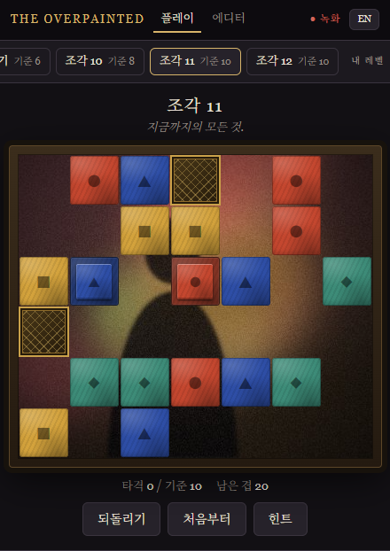
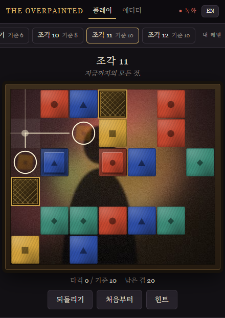
</p>

*왼쪽: 시작 화면. 오른쪽: 일곱 번 둔 첫 수, 왼쪽 위 빈칸에서 노랑 두 장을 친다. 이 테스터는 맨 아래 파랑 두 장 사이 빈칸도 일곱 번 첫 수로 골랐다.*

**평가 버튼: 이번에도 0번.**
두 테스터 모두 15번씩 깨는 동안 체감 난이도·아하·재미 버튼을 한 번도 누르지 않았다. 지금 모양으로는 이 데이터가 모이지 않는다.

**보인 것**
- **튜토리얼에 빈 곳이 있다.** "색이 다르면 녹지 않는다"를 보여 주는 판이 없다. 첫 테스터는 그냥 넘어갔지만, 이 테스터는 3번에서 그걸 두드려 가며 알아냈다.
- **"가장 적은 색이 미끼"는 두 사람 모두에게 통했다.** 7번은 둘 다 걸렸다. 11번도 예측기의 1순위 수에 일곱 번 걸렸다.
- **함정에서 나오는 길은 레벨마다 따로 준비해야 한다.** Not Yet과 7번에는 대사와 앞선 레벨이 실마리가 되지만, 11번에는 아무것도 없다.
- **사람마다 막히는 곳이 다르다.** 첫 테스터는 "방패"(Not Yet, 7)에서, 두 번째 테스터는 "욕심"(3, 4)과 종합(11)에서 막혔다. 난이도 곡선은 테스터 한 명으로 정할 수 없다.

**다음에 물어볼 것:** 4번에서 개발자 오버레이를 일부러 켰는지. 11번에서 무엇을 시도하다 그만뒀는지. 헛친 탭은 "어디가 되는지 찾아보는" 것이었는지.

---

## 2026-11-20 · 기준 횟수가 처음으로 의미를 갖다: 한꺼번에

> "4번 레벨이 누르는 순서를 다르게 해도 풀리네? …플레이 평가 기준에 몇 번의 터치만에 풀었는지도 도입하면 어떨까?
> 같은 타일이 4개 있으면 한 번에 없앨 수도 있고, 두 개씩 두 번에 나눠서 없앨 수도 있잖아? 이걸 역으로 이용해서 함정을 팔 수도 있을 것 같아."

**순서가 다른 풀이는 다회차 요소가 될까?**
솔버로 세어 보니 4번의 정답은 순서로 치면 14가지인데, **어느 타일끼리 짝지었는지**로 치면 2가지뿐이다. 나머지는 순서만 바꾼 것이다.
순서만 다르면 다시 풀어도 같은 생각을 반복할 뿐이다. 다회차 요소가 된다면 "다른 짝짓기 찾기"여야 한다. 그런데 함정 레벨은 답이 하나여야 날카롭다. 그래서 짝짓기가 여러 가지인 레벨에만 나중에 붙일 수 있는 기능으로 미뤘다.

**타격 수는 이미 평가 기준이었다. 다만 아무 의미가 없었다.**
화면에는 "타격 0 / 기준 4"가 있고, 기준을 넘기면 별이 준다. 그런데 **17개 레벨 중 15개는 어떻게 깨든 타격 수가 기준과 똑같았다.** 두 테스터가 모든 레벨을 "최소 횟수로" 깬 이유가 이것이다. 실력이 아니라, 깨기만 하면 그게 곧 최소였다.
세 장 타격은 지는 수(욕심)이거나 꼭 필요한 수(홀수)였다. 어느 쪽이든 고를 여지가 없었다. 그리고 같은 색 네 장을 한 번에 치는 수는 어느 레벨에도 없었다.

**한꺼번에 (8번 뒤, 5×4, 타일 12장, 기준 4).**
디자이너의 아이디어대로, 네 장을 한 번에 치는 수가 미끼다.

<p>
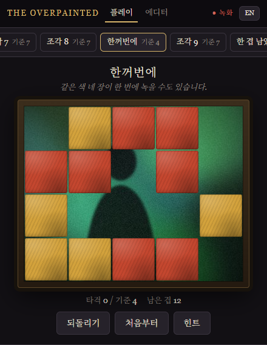
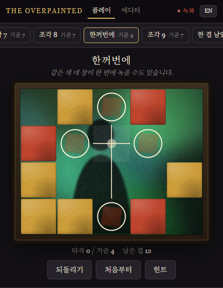
</p>

*왼쪽: 시작 화면. 오른쪽: 미끼. 가운데 위 빈칸에서 빨강 네 장이 한 번에 녹는다.*

- **왜 지나:** 네 장 중 왼쪽 빨강이 방패다. 그게 사라지면 노랑을 치던 칸의 위쪽 시선이 막혀 있던 노랑까지 닿아, 노랑 네 장이 한꺼번에 녹는다. 노랑은 5장이라 한 장이 남는다.
- **정답:** 노랑 세 장 → **같은 자리**에서 빨강 네 장 → 빨강 세 장 → 노랑 두 장, 이렇게 4타.
- **별:** 빨강을 두 장씩 나눠 쳐도 풀리지만 5타(★★)다. 처음으로 "깼지만 별 두 개"가 생겼다.

"세 장 욕심"이 **개수** 때문에 지는 수라면, 이건 **타이밍** 때문에 지는 수다. 개수는 맞는데 방패가 아직 필요하다. 그리고 유혹하는 것은 쾌감이 아니라 **별**이다. 기준 횟수 자체가 미끼가 된다.
첫 수 예측기는 미끼가 아니라 정답인 노랑 세 장을 본능 수로 꼽았다. 네 장 타격은 예측기가 본 적이 없는 수라 그렇다. 실제로 미끼가 통하는지는 플레이테스트로 확인해야 한다.

---

## 2026-11-20 · 색으로만, 그리고 묻지 않기

**문양을 뺐다.**

> "색을 잘 못 보는 플레이어는 고려하고 싶지 않아. 타일에 들어간 문양은 제거해 줘."

타일의 ●▲■◆ 문양을 없앴다. 이제 안료는 색으로만 구분한다.
같은 맥락에서, 다른 색 밑칠은 윗겹이 왼쪽 위로 치우쳐 있고 구석에 아래 색 문양이 있었다. 이것도 **같은 색 두 겹 칠과 같은 모양**으로 바꿨다. 아래 색 테두리 가운데에 윗겹이 놓인다. "안쪽 패널 하나 = 한 번 더"라는 원칙이 밑칠에도 그대로 적용된다.

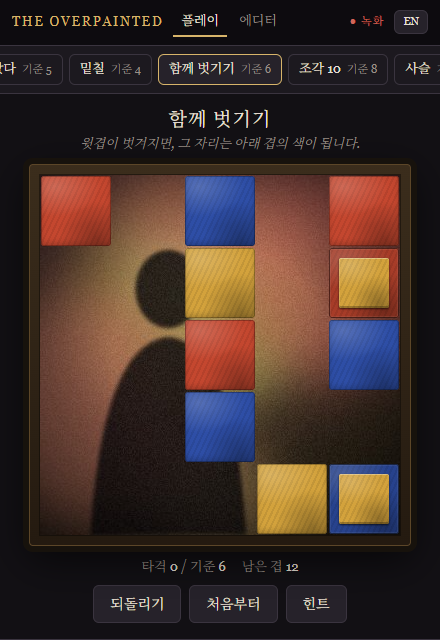

*함께 벗기기. 오른쪽 열의 두 타일은 노랑 윗겹 아래에 각각 빨강과 파랑이 있다.*

**평가 질문을 뺐다.**
클리어 화면의 체감 난이도·아하·재미 버튼은 두 테스터가 30번 깨는 동안 한 번도 눌리지 않았다.

> "어차피 실효성도 없고 말이야. 그냥 스프레드시트에 쌓이는 데이터를 분석하고, 부족한 부분은 내가 직접 질문을 통해 알아내는 게 좋겠어."

수를 둔 기록이 말해 주는 것은 기록으로 읽고, 느낌은 사람에게 직접 묻는다. 클리어 화면에는 이제 별과 타격 수, "다시"와 "다음"만 남았다.

**외부 리뷰에서 나온 버그 넷.**
외부 AI 리뷰(Gemini)에게 코드 전체를 보여 줬다. 지적한 것 중 코드에서 직접 확인된 버그 넷을 고쳤다.
- 에디터에서 레벨을 불러오면 밑칠이 사라졌다.
- **테스터용 웹 빌드에서도 D 키로 개발자 오버레이가 켜졌다.** 두 번째 테스터가 4번에서 켠 게 이것이다. 이제 웹 빌드에서는 패널도 키도 없다.
- 타격 애니메이션(0.28초) 도중 다른 레벨을 누르면, 이전 타격이 새 레벨에 적용될 수 있었다.
- 에디터에서 빈 판을 분석하면 오류가 났다.

---

## 2026-11-20 · 큰 그림은 Extra로: 사슬, 세 번째는 아래에

같은 리뷰가 짚은 것 중 디자이너가 가장 공감한 것은 **큰 판의 피로**였다. 디자이너 본인도 11·12번에서 풀기 싫어지는 걸 느꼈다.

**왜 지치는지 재 봤다.**
레벨마다 정답 수순을 따라가면서 두 가지를 셌다. 지는 수가 하나라도 있는 지점(함정 수)과, 실수한 뒤 막힐 때까지 더 둘 수 있는 수(진 뒤 남는 수)다.

| | 타일 | 기준 | 함정 수 | 진 뒤 남는 수 | 깨달음 문장 |
|---|---|---|---|---|---|
| Not Yet, 끝까지, 밑칠 | 7~9 | 3~4 | 3~4 | 1.0~1.5 | 각각 하나 |
| 7, 8 | 14 | 7 | 6 | 2.2~2.3 | 방패 |
| 11 | 18 | 10 | **8** | 3.5 (최대 8) | 없음 |
| 12 | 18 | 10 | 6 | **5.4** (최대 8) | 없음 |

- 함정이 한 줄로 이어져 있다. 11번은 10수 중 8수가 함정 지점이다. 일곱 번을 맞혀도 여덟 번째에서 틀리면 처음부터 다시 해야 하고, 맞힌 수를 다시 두는 건 노동이다.
- 진 줄 모르는 시간이 길다. 12번은 실수하고도 평균 5수 넘게 더 둔 다음에야 막힌다.
- 무엇을 찾아야 하는지 모른다. 11·12번은 깨달음 목록에서도 새 문장이 없는 "종합" 레벨이다. 퍼즐이 아니라 지뢰 찾기가 된다.

**그래도 큰 판을 좋아하는 사람이 있다.**

> "타일이 많은 큰 판은 플레이어 성향에 따라서 오히려 도전의식을 불러일으켜서 더 흥미를 느끼는 사람도 있을 것 같아. [첫 테스터] 같은 경우에는 11레벨과 12레벨을 클리어 했잖아?
> 그래서, Rail Bound 게임처럼 메인 진행 레벨이 아니라, Extra 레벨로 도전해 볼 수 있게 하면 어떨까."

Rail Bound는 메인 레벨 옆에 A, B 레벨이 가지처럼 붙어 있다. 메인 레벨을 깨면 열리고, 메인 진행에는 필요 없다.
그래서 11·12번을 메인에서 빼서 **Extra "큰 화폭 I·II"**로 옮겼다. 메인 코스의 마지막 레벨을 깨면 I이 열리고, I을 깨면 II가 열린다. "다음" 버튼은 Extra를 건너뛰고, Extra가 열리면 클리어 화면에 따로 버튼이 나온다.
기록이 끊기지 않도록 레벨 id는 그대로 두고 이름만 바꿨다.

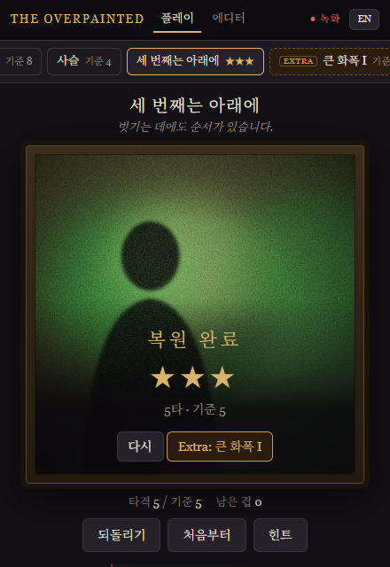

*메인 코스의 마지막 레벨을 깬 화면. 목록 오른쪽 끝에 점선 테두리의 Extra가 열렸고, 클리어 화면에 "Extra: 큰 화폭 I" 버튼이 나온다.*

**메인 코스는 작은 종합 레벨로 끝낸다.**
대신 메인 코스의 끝에는 기존 수제 레벨과 같은 크기로, 앞에서 배운 깨달음 둘셋이 부딪치는 판을 놓았다. 기준은 이렇게 정했다.
- 타일 12장 이하, 기준 6수 이하
- 함정 지점 2~4개, 핵심 함정은 첫 수에 두고 미끼와 덧칠꾼 대사를 붙인다
- 진 뒤 남는 수 2.5 이하, 짝짓기가 다른 정답 3가지 이하
- 한 문장으로 말할 수 있을 것

이 기준을 점수로 바꿔 탐색기를 돌렸고, 나온 후보를 한 수씩 따라가 보고 둘을 골랐다. 둘 다 5×5, 타일 10장, 정답은 하나뿐이다.

**사슬 (기준 4): "세 번째 장은 방패 뒤에 있고, 그 방패 뒤에 또 방패가 있다."**

<p>
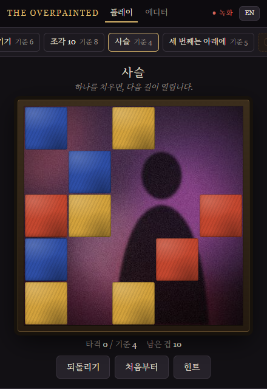
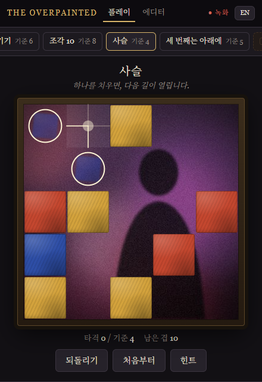
</p>

*왼쪽: 시작 화면. 오른쪽: 미끼인 파랑 두 장. 파랑은 3장이라 세 번째가 남는다.*

정답은 노랑 둘 → 노랑 둘 → 빨강 셋 → 파랑 셋이다. 첫 노랑 쌍을 치워야 다음 노랑이 세 장이 아니라 두 장으로 맞는다. 그 노랑이 빨강 세 장 타격을 막는 방패이고, 빨강 하나는 또 파랑 세 장 타격을 막는 방패다.
빨강도 파랑도 3장이라, 눈에 띄는 빨강 쌍과 파랑 쌍은 둘 다 지는 수다. 실수하면 평균 1.3수 안에 막힌다.

**세 번째는 아래에 (기준 5): "세 번째 파랑은 노랑 밑에 있다."**

<p>
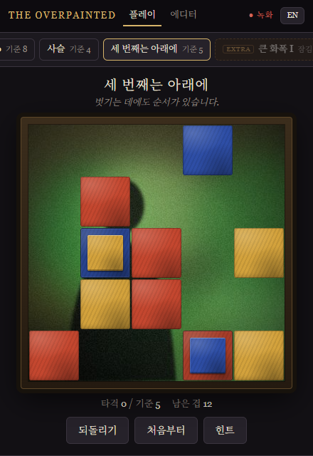
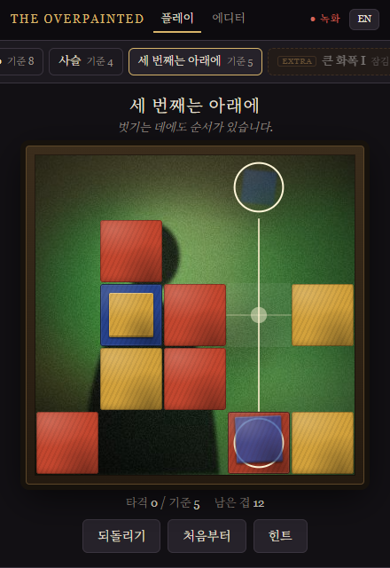
</p>

*왼쪽: 시작 화면. 노랑 밑에 파랑, 아래 줄의 파랑 밑에 빨강이 있다. 오른쪽: 미끼인 파랑 두 장 (예측기 94%).*

보이는 파랑은 둘뿐인데, 노랑 밑에 하나 더 있다. 정답은 빨강 쌍 → 노랑 윗겹 벗기기 → **같은 자리**에서 파랑 세 장 → 드러난 빨강까지 빨강 세 장 → 노랑 쌍이다.
벗기는 순서가 곧 답이다. 덧칠꾼: "같은 자리. 이번엔 파랑 셋이 대답했지."

**다음에 확인할 것:** 한꺼번에의 네 장 미끼가 실제로 물리는지. 메인 코스를 다 깬 테스터가 Extra를 여는지, 연다면 끝까지 하는지. 사슬과 세 번째는 아래에가 마지막 레벨로서 "종합"처럼 느껴지는지.

---

## 2026-11-23 · 종합 채우기: 아직 한 번도 만나지 않은 조합

7장 「종합」에는 사슬과 세 번째는 아래에 두 판뿐이었다. 그래서 아직 한 번도 같은 판에서 만나지 않은 메커니즘끼리 엮은 판을 세 개 더 넣었다.

탐색 조건은 이렇다. 기준 4~7수, 최소 풀이 2가지 이하, 시작 수 중 살길 2개 이하.
그리고 **두 메커니즘이 모두 일을 해야 한다.** 하나를 끄면(테이프를 한 장 빼거나, 밑칠을 걷거나, 혼색을 한 색으로 바꾸면) 못 풀거나 기준이 달라져야 한다.
나온 후보를 한 수씩 따라가 보고, 한 문장으로 말할 수 있는 셋을 골랐다. 셋 다 4×4다.

| 레벨 | 조합 | 문장 | 미끼 (예측기) |
|---|---|---|---|
| **하나는 숨어 있다** (기준 5) | 테이프 × 밑칠 | 보이는 빨강은 넷이지만 노랑 밑에 다섯 번째가 있다. 네 장 한꺼번에가 아니라, 테이프로 하나를 가려 세 장. | 네 장 한꺼번에 66% |
| **같은 편** (기준 4) | 혼색 × 두 겹 | 혼색 둘이 모두 파랑 편이다. 파랑 두 겹의 두 번째 짝이 혼색이다. (5장 *두 혼색*의 반전) | 고르게 갈림, 지는 수 87% |
| **빨강 몫** (기준 5) | 혼색 × 테이프 | 외톨이 빨강의 짝이 될 혼색이 파랑 타격에 잡혀 가지 않게, 테이프로 그 시선을 막는다. | 혼색을 파랑과 맞추는 수 22% |

순서는 사슬 → 하나는 숨어 있다 → 같은 편 → 세 번째는 아래에 → 빨강 몫이다. 밑칠 세기 판 둘(하나는 숨어 있다, 세 번째는 아래에) 사이에 혼색 판을 끼웠다. 무작위 성공률이 가장 낮은 빨강 몫(0.01%)을 마지막에 두었다.
Extra 큰 화폭 I은 이제 빨강 몫을 깨면 열린다. "메인 코스의 마지막 레벨을 깨면 열린다"는 규칙은 그대로다.

세 판 모두 핵심 함정이 첫 수에 있어서 덧칠꾼 대사를 붙였다. 하나는 숨어 있다는 브라우저에서 미끼 → 막힘 대사, 테이프 → 같은 자리 클리어 대사까지 확인했다.

**남은 것:** 셋 다 플레이테스트 전이다. 테이프 × 밑칠은 미끼로 네 장 십자를 썼는데, 한꺼번에(2장)에서 네 장 미끼가 실제로 물리는지는 아직 확인하지 못했다.

---

## 2026-11-23 · 중반 함정에도 덧칠꾼이 말한다

지금까지 덧칠꾼은 **첫 수가 미끼였을 때만** 말했다. 그래서 함정이 중간에 있는 레벨(테이프 4판, 한 겹 남았다, 두 혼색)에서는 몇 번을 져도 아무 말이 없었다.

**무엇을 "걸렸다"로 볼까.** 수를 둘 때마다 솔버로 판을 다시 본다. 방금 전까지 깰 수 있던 판이 이 수 다음에 깰 수 없게 되면, 이 수가 **블런더**다 (플레이테스트 분석의 블런더와 같은 정의).
레벨에는 `traps` 목록을 둔다. 함정 하나는 "이 타일들을 지우는 수"(`lifts`, 더 지워도 됨)나 "테이프를 붙이는 수"(`tape`: 칸 또는 `any`)다. 블런더가 처음 맞는 함정이 이번 판의 함정이다.
같은 수라도 첫 수일 때와 나중일 때 지는 이유가 다를 수 있어서, "N수 뒤부터만"(`after`)도 둘 수 있다. 한 겹 남았다의 가운데 노랑이 그렇다. 처음에 벗기면 남은 노랑 둘이 대각선이 되어 지고, 나중에 마저 지우면 파랑 세 장 타격을 막던 방패가 사라져서 진다.

**언제 말하나.** 미끼와 같다. 함정에 걸린 판이 막히면 `stuck`, 같은 방문에서 다시 깨면 `win`("이번엔 …"), 한 번도 안 걸리고 깨면 레벨의 `winClean`.
미끼가 있는 레벨은 미끼 대사가 먼저다. 되돌리기로 블런더 이전으로 돌아가면 걸린 기록도 지운다.

**여섯 레벨에 대사를 붙였다.** 아직 깰 수 있는 판에서 나올 수 있는 블런더를 모두 뽑아서, 함정마다 걸리는 블런더가 뭔지 보고 대사가 그 상황에 맞는지 하나씩 확인했다. 이 여섯 레벨에서는 모든 블런더에 대사가 있다.
테스트(`node tools/test.mjs`)는 함정마다 실제로 걸리는 블런더가 하나 이상 있는지, 두 언어 대사가 다 있는지 확인한다.

| 레벨 | 함정 (막혔을 때) |
|---|---|
| 한 겹 남았다 | 가운데 노랑을 너무 일찍 / 남은 노랑이 대각선 / 두 겹의 짝을 다 써 버림 / 위의 파랑 둘이 붙어서 남음 |
| 두 혼색 | 빨강의 짝이던 혼색을 파랑으로 / 파랑·혼색·빨강 한꺼번에 |
| 가리기 | 파랑 셋 한꺼번에 / 엉뚱한 자리에 테이프 / 붙어서 남는 파랑 둘 |
| 먼저가 아니다 | 아직 쓸 시선에 테이프 / 빨강 넷 중 셋 / 붙어서 남는 빨강 둘 |
| 그 자리에 | 방패 자리가 아닌 곳에 테이프 / 파랑 셋 한꺼번에 / 붙어서 남는 파랑 둘 |
| 두 겹을 기다려 | 그때, 그 자리가 아닌 테이프 / 노랑 셋 한꺼번에 / 붙어서 남는 노랑 둘 |

두 겹을 기다려에서 테이프를 일찍 붙여 막히는 판과, 다시 해서 깨는 판을 브라우저에서 확인했다.

**비용과 남은 것:**
- 함정 대사는 손으로 쓴다. 판 하나에 대사가 3~4쌍이고, "붙어 있는 둘은 서로를 볼 수 없다"처럼 레벨마다 겹치는 문장이 많다. 반복이 잔소리로 느껴지는지는 플레이테스트로 봐야 한다.
- 대사는 여전히 **막힌 뒤에만** 나온다. 진 줄 모르고 헤매는 시간은 그대로다 (두 번째 테스터의 헛친 탭 139번 중 75번이 이미 진 판에서 나왔다). 블런더 직후에 말하면 힌트가 되어 버려서 이번에는 하지 않았다.
- 미끼·함정이 없는 레벨(첫 용제, 십자, 조각 레벨들, 밑칠, 함께 벗기기, 큰 화폭)은 여전히 조용하다.

---

## 2026-11-23 · 덧칠꾼의 손글씨: 판 위에, 그 자리 옆에

디자이너: "플레이에 반응하는 텍스트들이 가독성이 좀 떨어진다. 게임들에서 캐릭터, 말풍선, 성우를 쓰는 데에는 다 이유가 있었구나."

말풍선과 목소리가 해 주는 일을 나눠 보면 네 가지다. **어디를 볼지**(사건이 난 자리에 뜬다), **누가 말하는지**, **읽는 속도**, **감정**.
지금 대사는 앞의 셋을 모두 놓치고 있었다. 버튼 아래에 작고 어두운 빨간 기울임체로 떠서, 판을 보던 눈이 화면 아래까지 내려가야 했다.
얼굴과 성우는 쓰지 않기로 했다. 덧칠꾼이 누구인지가 이 게임의 미스터리라서, 얼굴이나 목소리는 그 답을 먼저 줘 버린다. 대사가 100줄이 넘고, 두 언어이고, 아직 계속 고치는 중이기도 하다.

**바꾼 것:**
- 대사는 이제 **판 위의 손글씨 쪽지**다. 미끼 칸이나 판을 망친 칸 옆에 붙고, 그 칸에 덧칠꾼이 빨간 동그라미를 그린다. "같은 자리. 이번엔…" 같은 대사가 실제로 그 자리를 가리킨다.
- 글자가 한 자씩 **써지듯** 나타난다 (글자당 45ms).
- 판 위쪽 칸이면 쪽지가 칸 아래에, 아래쪽 칸이면 칸 위에 붙는다. 클리어했을 때는 결과 카드가 판 아래쪽을 덮으니 항상 위에 붙는다.
- 클리어할 때는 덧칠꾼이 먼저 쓰고, 동그라미가 사라진 뒤에 "복원 완료" 카드가 나온다 (1.6초 뒤). 동그라미와 카드 제목이 겹치지 않게 하려는 것이다.
- 다음 수, 되돌리기, 다시 시작을 하면 쪽지가 사라진다.

**폰트는 지금 고른다.** 가독성을 고치는 작업이라 폰트가 결과를 거의 정한다. 한글과 영문이 모두 있는 손글씨 후보 셋을 Google Fonts에서 불러와 **F 키**로 바꿔 볼 수 있게 했다.
- 나눔손글씨 붓 (Nanum Brush Script, 기본)
- 나눔손글씨 펜 (Nanum Pen Script)
- 동해 독도 (East Sea Dokdo)

**G 키**로 표시 방식도 바꿀 수 있게 했다. 종이 쪽지(바랜 종이에 검붉은 잉크)와, 캔버스에 직접 칠한 빨간 글씨 중 하나다.
쪽지와 동그라미가 그려지는 것은 데스크톱과 폰 폭(375px)에서 확인했다.

**디자이너의 선택: 나눔손글씨 펜, 캔버스에 직접.** 비교해 본 뒤 이 둘로 정했다. F/G 키와 나머지 후보는 뺐다.
종이 쪽지가 아니라 덧칠꾼이 그림 위에 직접 쓴 글씨가 되었다. 덧칠꾼은 *그림에 덧칠하는 사람*이니, 말도 그림 위에 칠한다.

**펜촉 소리.** 이 게임의 첫 소리다. 글자가 나타나는 박자(시작 250ms, 글자당 45ms)에 맞춰, 글자 하나에 짧은 사각거림을 한두 번 낸다. 걸러 낸 잡음을 짧게 끊어 쓰는 방식이라 음원 파일 없이 브라우저에서 바로 만든다.
소리마다 음높이, 길이, 크기를 조금씩 흔들어서 같은 소리가 반복되는 느낌을 줄였다. 다음 수, 되돌리기, 다시 시작을 하면 쪽지와 함께 소리도 멈춘다. **M 키**로 끄고 켤 수 있고, 브라우저에 기억된다.
소리가 글자 수만큼 예약되고 오류가 없는 것까지만 확인했다 (스물두 글자에 32번). 실제로 어떻게 들리는지는 디자이너가 들어 봐야 한다.

**남은 것:**
- 최종 폰트는 엔진 단계에서 라이선스를 확인하고 게임에 직접 넣는다. 지금은 Google Fonts에서 불러온다.
- 펜촉 소리는 합성음 프로토타입이다. 엔진 단계에서 실제 녹음한 펜촉 소리로 바꿀지 정한다.
- 플레이어가 붙인 테이프의 X가 "복원 완료" 카드 위에 그려지는 문제가 있다 (이번 변경 전부터 있었다).

---

## 2026-11-23 · 말 대신 방의 공기가 바뀐다

손글씨와 펜촉 소리를 넣고 나서 디자이너가 말했다.

> "조용하고, 미스터리한 분위기에 계속 조잘조잘 말 많은 느낌이 안 어울린다. 차라리 BGM으로 피드백을 주는 건 어떨까? BGM이 급박해지거나 단조로 바뀌는 걸로 잘못된 수를 뒀다는 걸 인지하게."

덧칠꾼의 대사는 두 가지 일을 했다. **상태**("판이 틀어졌다")를 알리고, **이유**("다섯 번째는 노랑 밑에")를 짚었다. 말이 많다는 느낌은 이유를 자주, 길게 말하는 데서 왔다.
음악은 상태를 알리는 데 맞고, 이유는 말하지 못한다. 그래서 둘을 나눴다. **상태는 음악과 그림이 조용히, 이유는 덧칠꾼이 드물게.**

**음악이 즉시 바뀌면 판별기가 된다.** 판을 망친 수를 두는 순간 음악이 바뀌면, 플레이어는 "한 수 → 음악이 바뀌었나 → 되돌리기"로 머리를 쓰지 않고 풀 수 있다. 두드려 보는 플레이어라면 특히 그렇다.
그래서 **늦게** 바꾼다. 판을 망친 뒤 두 수를 더 두거나, 25초가 지나거나, 더 둘 수 없게 되었을 때 바뀐다.
- 음악: 평온한 곡에서 같은 빠르기, 같은 중심음(D)의 어두운 곡으로 9초에 걸쳐 넘어간다. 소리도 조금 먹먹해진다(저역 통과 필터).
- 그림: 물감이 마른 것처럼 7초에 걸쳐 채도와 밝기가 빠진다. 막혔을 때 나오는 "물감이 굳었습니다"와 같은 이미지다.
- 되돌리기나 다시 시작으로 판을 망친 수 이전으로 돌아가면 천천히 원래대로 돌아온다.
- 진 줄 모르고 오래 헤매는 문제(두 번째 테스터의 헛친 탭 139번 중 75번이 이미 진 판에서 나왔다)는 이걸로 줄어들기를 기대한다.

**덧칠꾼은 한 번만 말한다.** 막혔을 때의 대사와 한 번도 안 걸리고 깼을 때의 대사(`winClean`)는 화면에 내지 않는다. 미끼나 함정에 걸렸다가 결국 깼을 때의 "같은 자리. 이번엔…" 한 줄만 남겼다. 동그라미와 펜촉 소리도 이때만 나온다.
막혔을 때 대사는 레벨 파일에 그대로 두었다. 나중에 다른 곳에 쓸 수 있다.

**음악은 ElevenLabs Music으로 만든다** (`tools/music.mjs`, 모델 `music_v2_5`, 2분짜리 두 곡, 가사 없음).
두 곡은 늘 같이 재생되고, 둘의 음량 비율만 바뀐다. 곡의 끝과 처음은 6초 동안 겹쳐서 이음매가 들리지 않게 반복한다. 소리는 M 키로 펜촉 소리와 함께 끄고 켠다.
첫 생성 시도는 실패했다. API 키의 Music Generation 권한이 꺼져(No Access) 있었다. 디자이너가 권한을 켠 뒤 다시 만들었다 (곡마다 10초 정도 걸렸다). 음악 파일이 없으면 게임은 음악 없이 그대로 돌아간다.
- 두 곡의 크기를 재 보니 어두운 곡이 평균 6dB 컸다 (평온 -25.6dB, 어두움 -19.5dB). 판이 틀어질 때 음악이 커지면 안 되므로 어두운 곡을 절반 음량으로 튼다.
- 평온한 곡은 끝 3초가 조용해진다. 반복할 때 6초를 겹치므로 이음매는 덮인다.
- 숨겨진 탭에서는 브라우저가 타이머를 1분에 한 번 정도로 늦춘다. 그래서 다음 반복은 60초 앞서 예약한다.

**펜촉 소리도 ElevenLabs로 만들었다** (`tools/sfx.mjs`, 효과음 생성, 6초). 마른 종이에 강철 펜촉으로 빠르게 쓰는 소리다.
녹음을 통째로 틀지 않고, 펜촉이 실제로 긁히는 구간(10ms 단위로 재서 가장 큰 소리의 25%가 넘는 곳)에서 35~75ms 조각을 잘라 글자마다 한두 개씩 튼다. 글씨가 나타나는 박자와 맞추기 위해서다. 녹음을 불러오기 전에는 합성음으로 대신한다.

확인한 것: 하나는 숨어 있다에서 미끼를 두고 한 수 더 두었을 때는 그대로였고, 막히자 그림이 말랐고 대사는 나오지 않았다. 되돌리기로 미끼 이전까지 돌아가니 원래대로 돌아왔다. 다시 해서 깨니 "같은 자리" 대사만 나왔다.
오디오는 호출 기록으로 확인했다. 첫 클릭에 두 곡이 함께 시작하고, 막히면 평온한 곡이 0.42에서 0.05로, 어두운 곡이 0에서 0.21로 넘어가고, 되돌리면 돌아온다. "같은 자리" 대사에서는 펜촉 녹음 조각이 30번 울린다. **실제로 어떻게 들리는지는 아직 아무도 들어 보지 않았다.**

**비용과 위험:**
- **되돌리기도 단서가 된다.** 어두워진 뒤 한 수씩 되돌리다 보면, 밝아지는 순간에 "이 수가 문제였다"를 알 수 있다. 판별기보다는 약하지만 힌트 하나 정도의 정보다. 플레이테스트에서 이렇게 쓰는지 본다.
- **늦은 신호는 놓칠 수 있다.** 두 수, 25초는 감으로 정한 값이다. 소리를 끄고 하는 사람은 그림 변화만 본다.
- **ElevenLabs 약관:** 유료 플랜은 상업적 사용이 허용되지만, "Studio Games"는 예외로 적혀 있다. 출시 전에 플랜 조건을 확인해야 한다.

---

## 2026-11-24 · 덧칠꾼의 글씨를 걷어 내다

디자이너가 음악과 그림 변화는 잘 어울린다고 했다. 대신 펜촉 소리가 조용한 음악 위에 너무 크게 났다 (음악보다 약 25dB 컸다. 20dB 줄였다).
그리고 이렇게 정했다.

> "텍스트가 나오는 연출이 계속 거슬린다. 완전히 제거하고 나중에 다시 생각해 보자. 일단은 BGM과 색상 변화만으로 퍼즐을 잘못 풀고 있음을 인지하게 하는 게 게임에 어울린다."

**걷어 낸 것:** 판 위의 손글씨, 동그라미, 펜촉 소리, 클리어 카드를 늦게 띄우던 것, 손글씨 폰트, 미끼에 걸렸는지 기억하던 상태. 펜촉 효과음 파일과 생성 스크립트도 지웠다. 프롬프트는 앞 일지에 남아 있다.
이제 게임 안에서 덧칠꾼은 말하지 않는다. 플레이어가 틀렸다는 것은 늦게 바뀌는 음악과 마르는 그림으로만 알린다.

**남겨 둔 것 (나중에 다시 생각할 때를 위해):**
- 레벨 파일의 미끼(`bait`)와 대사(`voice`), 중반 함정(`traps`)과 그 대사. 쓰이지 않지만 지우지 않았다.
- `core/traps.js`와 그 테스트. 함정마다 실제로 걸리는 블런더가 있는지는 계속 검사한다.
- 판을 망친 순간을 아는 장치(`noteBlunder`). 지금은 음악과 그림을 바꾸는 데 쓴다.

확인한 것: 하나는 숨어 있다에서 막히면 그림이 마르고, 다시 깨도 아무 글씨가 나오지 않는다. 콘솔 오류 없음, 테스트 15개 통과.

**다음에 다시 생각할 것:** 덧칠꾼이 다시 나온다면 언제, 어떻게? 레벨 사이(챕터 시작이나 끝), 복원이 끝난 그림 위, 또는 아예 말 대신 흔적(붓자국, 덮인 사람의 윤곽)으로.

---

## 그 시점을 다시 플레이하려면

```
git checkout prototype-0.1
node tools/serve.mjs          # http://localhost:5173
```

외부 라이브러리를 쓰지 않아서 (브라우저와 Node 기본 기능만), 오래 지나도 그대로 돌아가도록 만들었습니다.
최신으로 돌아오려면 `git checkout main`.

| 태그 | 날짜 | 무엇 |
|---|---|---|
| `prototype-0.1` | 2026-11-18 | 첫 플레이어블. 13개 레벨, Not Yet 3차, 덧칠꾼 대사, 두 겹 칠 2차, 한국어 |
| `prototype-0.2` | 2026-11-20 | 메인 18개 + Extra 2개. 방패·밑칠 레벨, 한꺼번에, 종합 레벨 사슬·세 번째는 아래에, 큰 판은 Extra로. 문양 없이 색으로만, 링크 하나로 하는 플레이테스트, 평가 질문 없음 |
